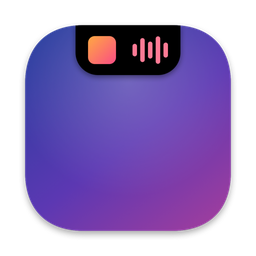
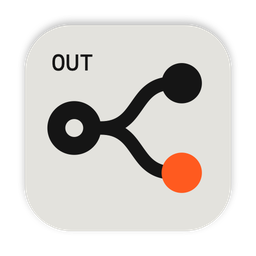
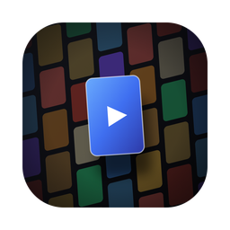

<h1 align="center">Theoron</h1>

<i>θεωρῶν — “the one who contemplates”</i>

A small studio crafting polished native apps — fast, beautiful and private.

  
  

 

<table>
  <tr>
    <td align="center" valign="top" width="33%">
       
      
      <h3>NotchIsland</h3>
      
Dynamic Island for MacBooks with a notch: music with a live equalizer, notifications, a timer, a file shelf and stats.

      

      
 

    </td>
    <td align="center" valign="top" width="33%">
       
      
      <h3>Outputs</h3>
      
Your Mac's sound on several headphones and speakers at once, each with its own volume, delay and EQ.

      

      
 

    </td>
    <td align="center" valign="top" width="33%">
       
      
      <h3>Conversio</h3>
      
Windows games from Steam on Apple Silicon Macs, free: one-click Wine and Steam, DirectX 12 through D3DMetal.

      

      
 

    </td>
  </tr>
</table>

<table>
  <tr>
    <td valign="top" width="33%"><b>Native</b> Built with Apple's own frameworks, no heavy dependencies.</td>
    <td valign="top" width="33%"><b>Private</b> No analytics; your data stays on your device.</td>
    <td valign="top" width="33%"><b>Crafted</b> Animations, sound and haptics are designed with care.</td>
  </tr>
</table>

Невелика студія нативних застосунків

